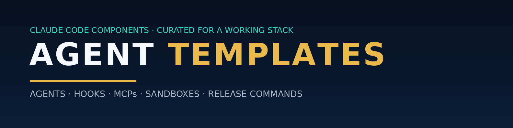

# Agent Templates — Claude Code components, curated for a working stack

A big, opinionated pack of agents, hooks, commands, MCP configs and sandbox runtimes — drawn from a 1,940+ component open-source catalog and selected against the gaps in one builder's actual stack (agent teams, a trading desk, a lead engine, Chrome extensions, and a lot of GitHub releases done by hand).

Not a mirror of the whole catalog (1,940+ components). This is the ~330 files that plug real holes. Full list: [INDEX.md](INDEX.md).

## Why these — the gap map

| Gap | What fills it |
| --- | --- |
| Sandboxes that are folders, not boundaries | `sandbox/` — real Docker, E2B and Cloudflare isolation runtimes |
| Safety rules that live in prose | `hooks/security/` — subagent read-only guard, dangerous-command blocker, secret scanner, env-file protection, force-push blocker |
| Design/TDD gates kept by honour system | `hooks/quality-gates/` — plan-gate, tdd-gate, scope-guard |
| No observability on agent runs | `hooks/monitoring/` — LangSmith tracing, context timeline |
| Releases done by hand, every time | `commands/git/` + `commands/deployment/` — release prep, changelog, automated releases; `agents/git/` |
| Thin benches in security, docs, devops, data | `agents/security/`, `agents/documentation/`, `agents/devops-infrastructure/`, `agents/database/`, `agents/data-ai/`, `agents/performance-testing/` |
| Obsidian in the blueprint, no vault agents | `agents/obsidian-ops-team/` — 7 vault agents |
| MCP servers wired ad hoc | `mcps/` — browser automation (Playwright), databases (Supabase/Postgres/Redis/Mongo), devtools (GitHub, Context7, Firecrawl, Chrome DevTools), filesystem, web, research |

## Use it

Components are plain files — read before you install anything.

- **Claude Code:** copy agents into `.claude/agents/`, commands into `.claude/commands/`, hooks into `.claude/hooks/` with their settings snippets, MCP configs into your MCP settings.
- **Any other agent surface:** agents and commands are markdown and port directly; hooks are Claude Code settings hooks and need adapting.
- Or install from the source catalog with its own CLI: `npx claude-code-templates@latest --agent <category>/<name>`.

## Credit & license

All components come from [davila7/claude-code-templates](https://github.com/davila7/claude-code-templates) by Daniel (San) Ávila and contributors, MIT-licensed — see [LICENSE](LICENSE). This repo is a curated selection with selection notes, not an official release of that project, and is not affiliated with it or with Anthropic.
